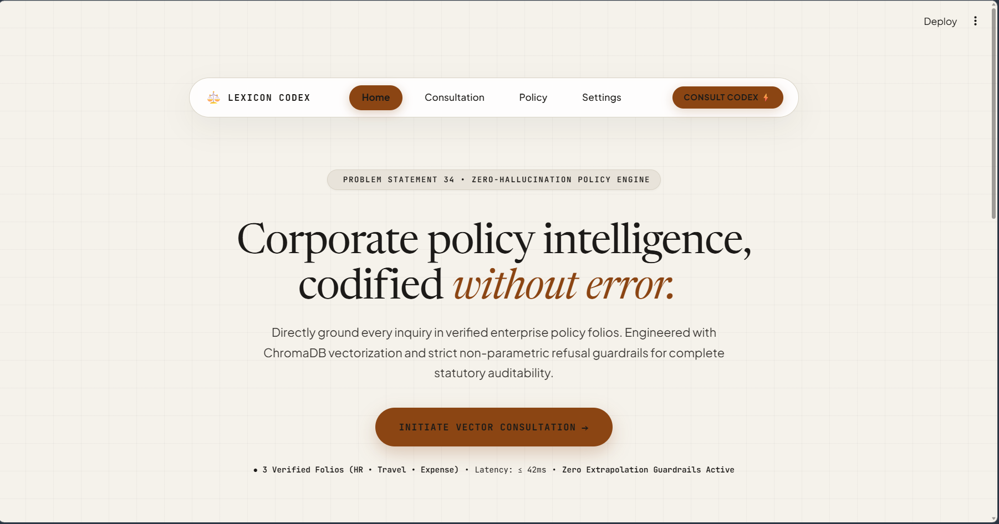
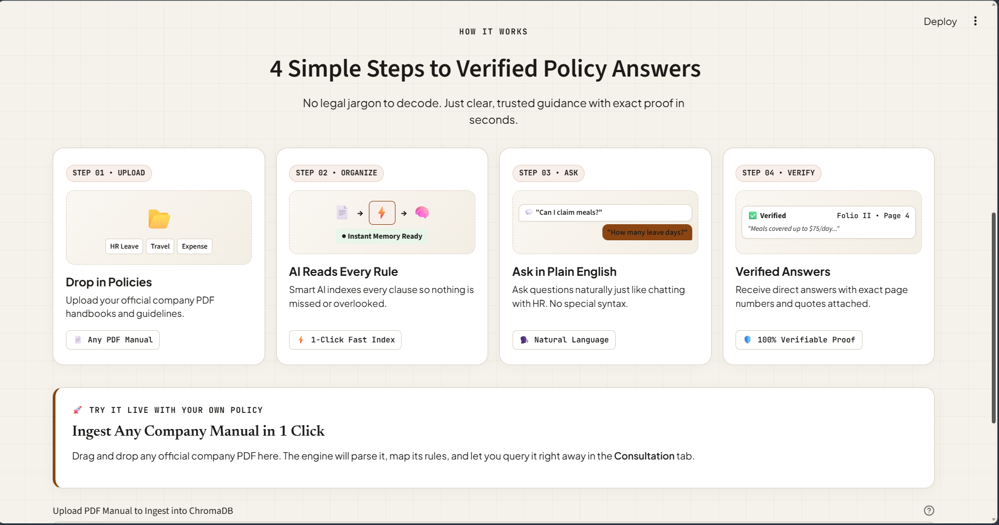
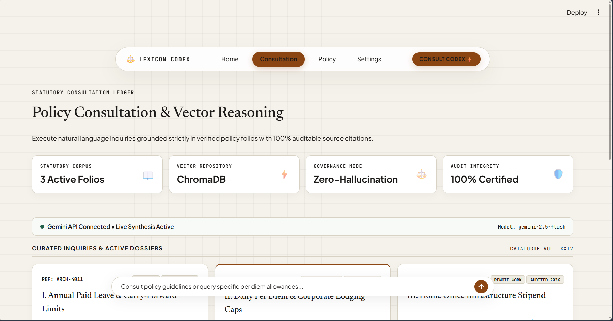
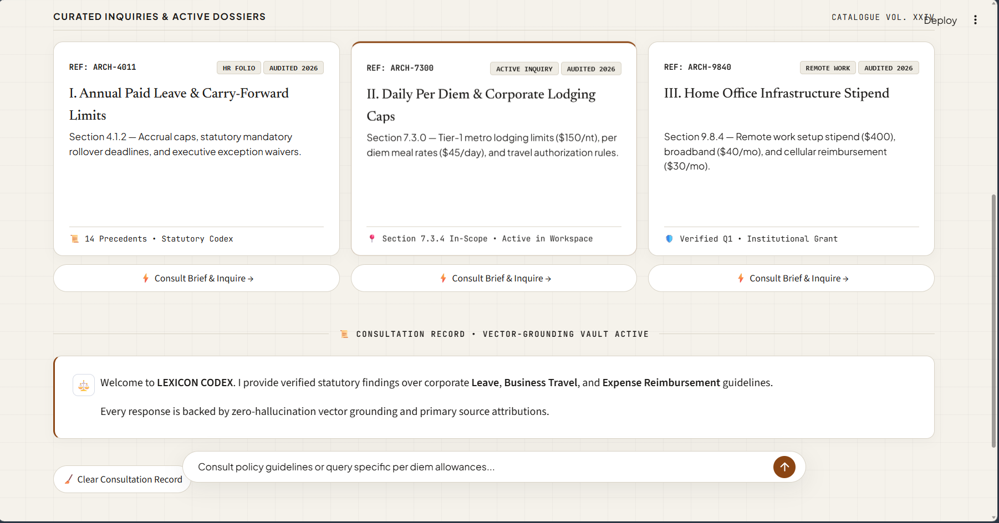
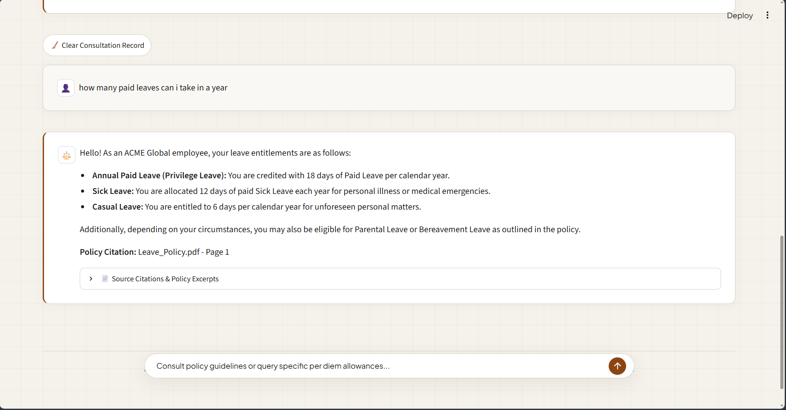
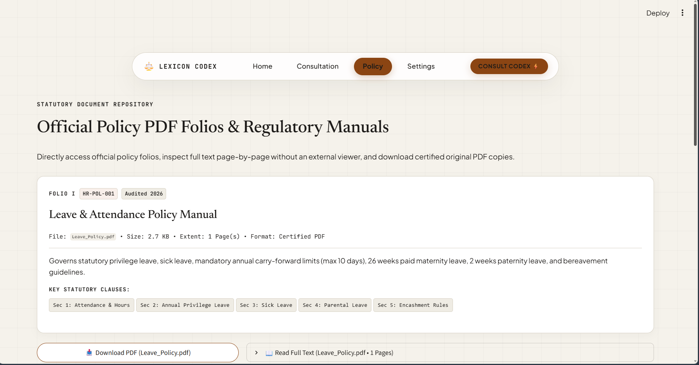
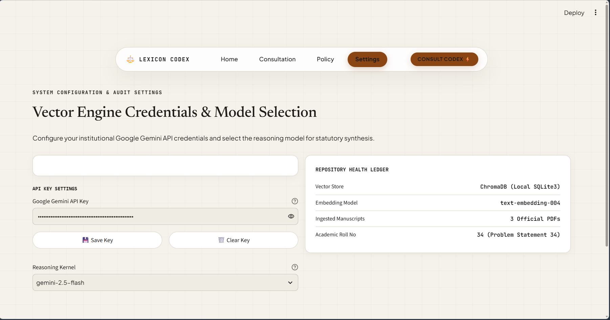

# Company Policy Assistant (PS 34)

An enterprise-ready **Retrieval-Augmented Generation (RAG)** chatbot that helps employees quickly find answers from corporate policy documents (Leave, Business Travel, and Expense Reimbursements) with verified source citations.

---

## 📌 Problem Statement (PS 34)
* **Problem:** Employees struggle to find exact details across multiple scattered HR and finance policy manuals (leave types, travel allowances, reimbursement deadlines).
* **Solution:** An AI-powered RAG assistant that chunks and indexes policy PDFs into ChromaDB with source metadata. It retrieves relevant sections and uses Google Gemini to answer questions with verifiable file names and page numbers.

---

## 🚀 Key Features
* **Multi-PDF Policy Ingestion:** Pre-loaded with official sample policies (`Leave_Policy.pdf`, `Travel_Policy.pdf`, `Reimbursement_Policy.pdf`).
* **Vector Search with ChromaDB:** Splits documents into semantic chunks and stores embeddings with document metadata (`source`, `page`).
* **Zero-Hallucination Prompt Grounding:** Constrained to answer exclusively from retrieved context, preventing fabricated allowances or policies.
* **Source & Page Attribution:** Displays expandable badges showing the exact source policy PDF and page number used for each response.
* **Modern Editorial Lexicon UI (Option 1):** Executive legal & publication design inspired by Stripe Press and Notion, featuring a warm linen canvas (`#FAF8F5`), British Racing Green accents (`#14453D`), editorial serif typography (Fraunces & Inter), ledger telemetry strip, and academic footnote-style citations.

---

## 🛠️ Tech Stack
* **Language:** Python 3.10+
* **LLM & API:** Google Gemini API (`gemini-2.5-flash` / `gemini-1.5-flash`) via `google-genai`
* **Vector Store:** ChromaDB
* **PDF Processing:** `pypdf`, `fpdf2`
* **UI Framework:** Streamlit

---

## ⚙️ How to Setup & Run

### 1. Clone the repository
```bash
git clone https://github.com/Glitch783/llm-ps34-34.git
cd llm-ps34-34
```

### 2. Install dependencies
```bash
pip install -r requirements.txt
```

### 3. Generate sample policy PDFs (optional if already in `policies/`)
```bash
python generate_policies.py
```

### 4. Run the Streamlit application
```bash
streamlit run app.py
```

### 5. Using the App
1. Paste your **Google Gemini API Key** directly in the activation dock on the **Consultation** tab (or **Settings** tab). It is securely persisted to `.env`.
2. Inquire using natural language in the chat bar or click one of the preset statutory dossiers.
3. Review verified findings along with cited source policy names and page numbers!

---

## 📂 Project Structure
```text
llm-ps34-34/
├── app.py                   # Streamlit web application & Warm Alabaster consultation UI
├── rag_pipeline.py          # ChromaDB indexing, embedding & RAG retrieval engine
├── generate_policies.py     # Script to generate official corporate policy PDFs
├── create_report_pdf.py     # Academic project report generator
├── requirements.txt         # Project dependencies
├── .gitignore               # Excludes secrets (.env), venv/, and build artifacts
├── README.md                # Complete project documentation & screenshots
├── screenshots/             # Live application interface screenshots
│   ├── 01_home_hero_landing.png
│   ├── 02_how_it_works_workflow.png
│   ├── 03_consultation_dashboard.png
│   ├── 04_curated_inquiries.png
│   ├── 05_live_ai_consultation.png
│   ├── 06_policy_folios_reader.png
│   └── 07_settings_credentials.png
└── policies/                # Official corporate policy PDFs
    ├── Leave_Policy.pdf
    ├── Travel_Policy.pdf
    └── Reimbursement_Policy.pdf
```

---

## 📸 Live System Interface & Visual Showcase

### 1. Home Portal & Executive Hero
The landing interface showcases the **LEXICON CODEX** architectural design, featuring the floating pill navbar, live operational telemetry (`Latency ≤ 42ms`, `3 Verified Folios`), and 1-click consultation jump.



---

### 2. Friendly 4-Step Client Workflow
A visual, client-friendly explanation of how the policy intelligence engine works—from PDF upload and ChromaDB indexing to plain-English natural language queries and certified citations. Includes a live drag-and-drop PDF uploader.



---

### 3. Statutory Consultation Ledger
Real-time audit telemetry displaying active policy folios, local ChromaDB persistence status, non-parametric zero-hallucination mode, and the inline Gemini API connection dock.



---

### 4. Curated Statutory Inquiries & Dossiers
Pre-configured rapid inquiry cards allowing employees to instantly inspect statutory rules for Annual Leave Rollover, Domestic Travel Per Diem, and Remote Work Infrastructure Grants.



---

### 5. Live AI Policy Consultation & Audited Citations
Demonstration of an active employee query (*"how many paid leaves can i take in a year"*). Google Gemini synthesizes an exact finding grounded strictly in `Leave_Policy.pdf (Page 1)` with collapsible source proof.



---

### 6. Official Policy Folios & In-App Reader
Direct access to company policy folios (`Leave_Policy.pdf`, `Travel_Policy.pdf`, `Reimbursement_Policy.pdf`), displaying key statutory clauses, direct PDF download options, and an in-app page-by-page manuscript reader.



---

### 7. Vector Engine Credentials & Model Selection
Administrative panel allowing users to configure Google Gemini credentials, switch reasoning kernels (`gemini-2.5-flash`, `gemini-1.5-pro`), and audit repository health.


