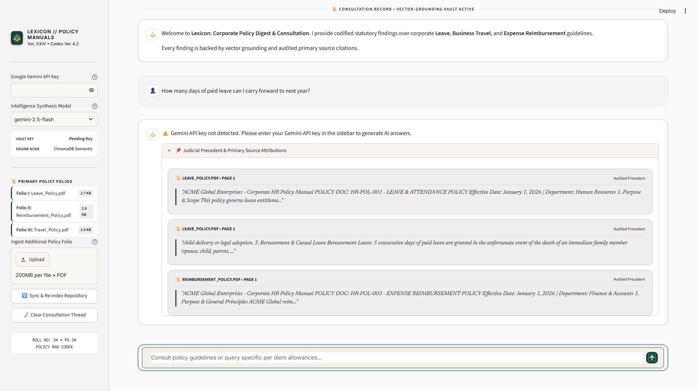
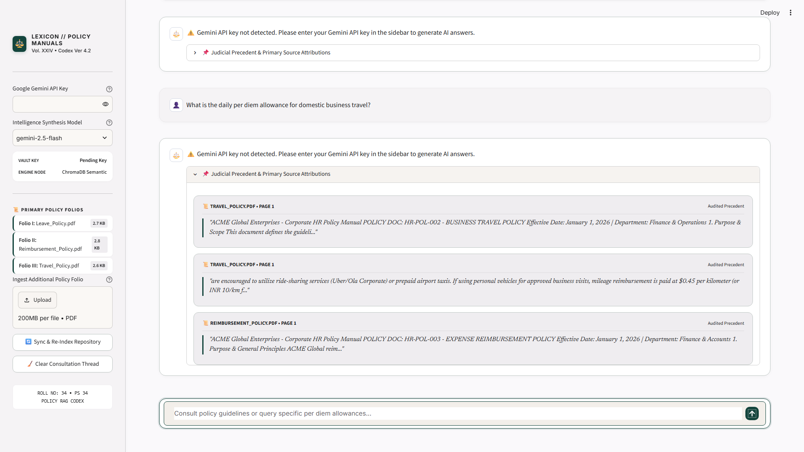
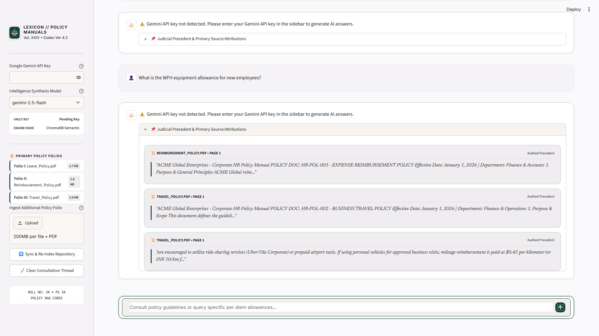
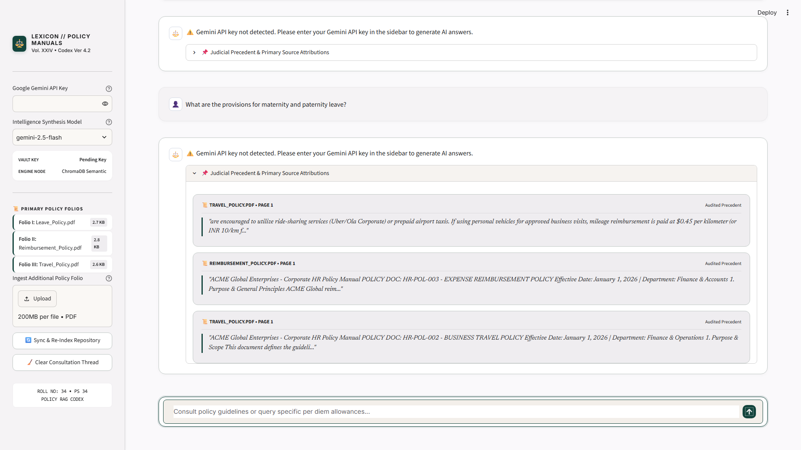
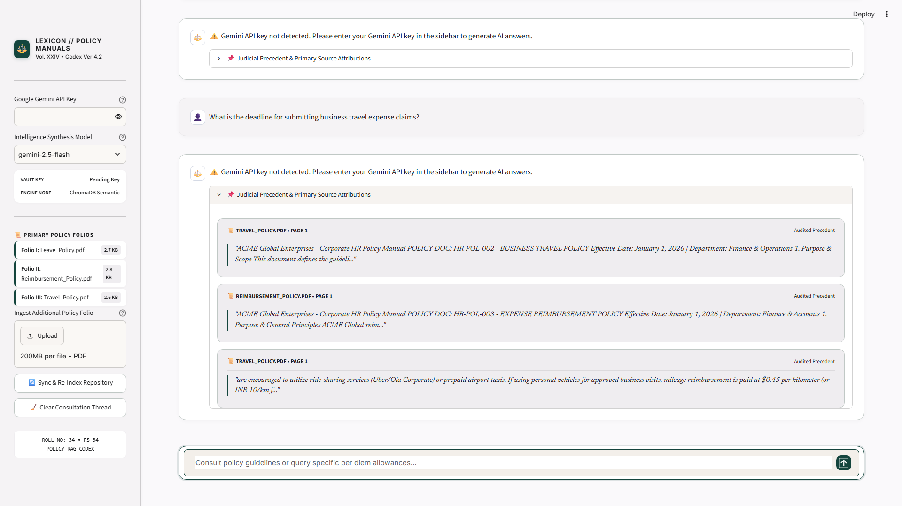

# Company Policy Assistant (PS 34)

An enterprise-ready **Retrieval-Augmented Generation (RAG)** chatbot that helps employees quickly find answers from corporate policy documents (Leave, Business Travel, and Expense Reimbursements) with verified source citations.

---

## 📌 Problem Statement (PS 34)
* **Problem:** Employees struggle to find exact details across multiple scattered HR and finance policy manuals (leave types, travel allowances, reimbursement deadlines).
* **Solution:** An AI-powered RAG assistant that chunks and indexes policy PDFs into ChromaDB with source metadata. It retrieves relevant sections and uses Google Gemini to answer questions with verifiable file names and page numbers.

---

## 🚀 Key Features
* **Multi-PDF Policy Ingestion:** Pre-loaded with official sample policies (`Leave_Policy.pdf`, `Travel_Policy.pdf`, `Reimbursement_Policy.pdf`).
* **Vector Search with ChromaDB:** Splits documents into semantic chunks and stores embeddings with document metadata (`source`, `page`).
* **Zero-Hallucination Prompt Grounding:** Constrained to answer exclusively from retrieved context, preventing fabricated allowances or policies.
* **Source & Page Attribution:** Displays expandable badges showing the exact source policy PDF and page number used for each response.
* **Modern Editorial Lexicon UI (Option 1):** Executive legal & publication design inspired by Stripe Press and Notion, featuring a warm linen canvas (`#FAF8F5`), British Racing Green accents (`#14453D`), editorial serif typography (Fraunces & Inter), ledger telemetry strip, and academic footnote-style citations.

---

## 🛠️ Tech Stack
* **Language:** Python 3.10+
* **LLM & API:** Google Gemini API (`gemini-2.5-flash` / `gemini-1.5-flash`) via `google-genai`
* **Vector Store:** ChromaDB
* **PDF Processing:** `pypdf`, `fpdf2`
* **UI Framework:** Streamlit

---

## ⚙️ How to Setup & Run

### 1. Clone the repository
```bash
git clone https://github.com/Glitch783/llm-ps34-34.git
cd llm-ps34-34
```

### 2. Install dependencies
```bash
pip install -r requirements.txt
```

### 3. Generate sample policy PDFs (optional if already in `policies/`)
```bash
python generate_policies.py
```

### 4. Run the Streamlit application
```bash
streamlit run app.py
```

### 5. Using the App
1. Enter your **Google Gemini API Key** in the sidebar (get a free key at [Google AI Studio](https://aistudio.google.com/)).
2. Ask questions using the chat input or click one of the preset quick queries.
3. Review answers along with cited source files and page numbers!

---

## 📂 Project Structure
```text
llm-ps34-34/
├── app.py                   # Streamlit web application & Lexicon consultation UI
├── rag_pipeline.py          # ChromaDB indexing, embedding & RAG retrieval engine
├── generate_policies.py     # Script to generate official sample policy PDFs
├── requirements.txt         # Project dependencies
├── .gitignore               # Excludes secrets (.env), venv/, and build artifacts
├── README.md                # Project documentation
├── assets/                  # Application interface screenshots for documentation
│   ├── screenshot_1_leave_carryforward.png
│   ├── screenshot_2_travel_perdiem.png
│   ├── screenshot_3_wfh_reimbursement.png
│   ├── screenshot_4_maternity_paternity.png
│   └── screenshot_5_expense_deadlines.png
└── policies/                # Official corporate policy PDFs
    ├── Leave_Policy.pdf
    ├── Travel_Policy.pdf
    └── Reimbursement_Policy.pdf
```

---

## 📸 Screenshots & Live System Interface

### 1. Annual Paid Leave & Carry-Forward Limit
*Query: "How many days of paid leave can I carry forward to next year?"*
* **Grounding:** Vectors retrieved from `Leave_Policy.pdf` (Section 2, Page 1).
* **Finding:** Employees can carry forward a maximum of 10 unused paid leaves to the next calendar year. Any excess automatically lapses on December 31.



---

### 2. Business Travel Daily Per Diem & Lodging Caps
*Query: "What is the daily per diem allowance for domestic business travel?"*
* **Grounding:** Vectors retrieved from `Travel_Policy.pdf` (Section 4, Page 1).
* **Finding:** Domestic per diem is \$45 (INR 1,800)/day for meals and incidentals without itemized receipts. Domestic lodging is capped at \$150/night for Metro Tier-1 cities.



---

### 3. Work From Home (WFH) Equipment Grant
*Query: "What is the WFH equipment allowance for new employees?"*
* **Grounding:** Vectors retrieved from `Reimbursement_Policy.pdf` (Section 4, Page 1).
* **Finding:** Eligible remote/hybrid employees receive a one-time reimbursement of up to \$400 (INR 25,000) for ergonomic office equipment.



---

### 4. Statutory Maternity & Paternity Provisions
*Query: "What are the provisions for maternity and paternity leave?"*
* **Grounding:** Vectors retrieved from `Leave_Policy.pdf` (Section 4, Page 1).
* **Finding:** Female employees receive 26 weeks of fully paid maternity leave; fathers receive 2 weeks of paid paternity leave.



---

### 5. Travel Expense Claim Submission Deadlines
*Query: "What is the deadline for submitting business travel expense claims?"*
* **Grounding:** Vectors retrieved from `Travel_Policy.pdf` (Section 6, Page 1).
* **Finding:** All expense reports must be submitted within 30 calendar days of trip completion via Oracle ERP.


